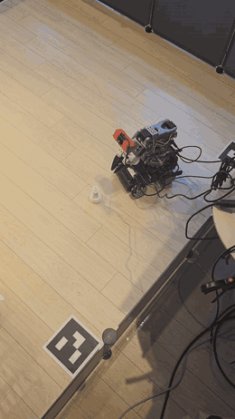
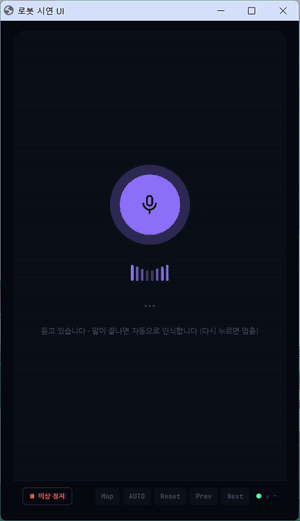

<div align="center">

# 🤖 Grippers

**말로 지시하면 장판 위 물건을 스스로 찾아 정리하고, 부탁하면 사람 손에 건네주는 피지컬 AI 로봇**

탑뷰 카메라 2대 · 메카넘 차체 · SO-ARM101 로봇팔 · 학습된 파지 정책(ACT)

청년취업사관학교(SeSAC) **Intel AI for X** 과정 팀 프로젝트 · 2026.08 ~ 2026.10 · 5인 팀 **팀장**

</div>

> [!NOTE]
> 이 레포는 팀 저장소 [grippers-intel/grippers](https://github.com/grippers-intel/grippers)를 포크한 **개인 포트폴리오**입니다.
> 코드는 팀 저장소와 같고, 이 README만 제 역할과 결과 중심으로 다시 썼습니다. 팀 원본 README는 [docs/TEAM_README.md](docs/TEAM_README.md)에 있습니다.

---

## 🎬 데모

<table>
<tr>
<td align="center" width="50%"></td>
<td align="center" width="50%"></td>
</tr>
<tr>
<td align="center"><b>학습된 정책으로 기물 파지</b><br>실기 촬영 · 2배속</td>
<td align="center"><b>"물건들 다 정리해 줘" → 6개 모두 바구니에</b><br>시연 UI 화면 · 12배속 (2026-10-05)</td>
</tr>
</table>

## 📊 한눈에 보기

| 항목 | 결과 | 근거 |
|---|---|---|
| 6기물 정리 | **6/6** (첫 시도 파지 6/6) | 2026-10-13 교육장 최종 확인 |
| 바구니 앞을 막는 배치 | **5/5** | 막는 기물부터 치우도록 순서 판단 |
| "가져와" (사람 손에 건네기) | **2/2** | 손이 옮겨 가도 보이는 손으로 |
| 멈춤 · 무응답 · 폭주 | **0** | 최종 확인 모든 판 |
| 파지 정책 비교 | ACT **86 %** (6/7) vs Diffusion Policy 43 % (6/14) | 같은 날 실기 비교 → ACT 채택 |
| 탑뷰 위치추정 반복도 | **0.51 mm / 0.084°** | 5,084 프레임 |
| 노트북 CPU (작업 중) | 46.6 % → **19.0 %** | 물체 검출을 내장 그래픽(OpenVINO)으로 이전 |
| 테스트 | Host 241개 · Pi 87개 + CI 4개 작업 | push 마다 린트 · 테스트 |

자세한 측정값과 한계: [docs/results.md](docs/results.md)

## 🎯 무엇을 하나

| 지시 (입력창 · 마이크) | 로봇이 하는 일 |
|---|---|
| "모두 정리해줘" · "장난감만 정리해줘" | 작업장 안 해당 기물을 하나씩 찾아 집어 **바구니에 넣는다** — 다 없어질 때까지 |
| "룩 가져와" | 룩을 집어 장판 위에 보이는 **사람 손 앞으로 가서 건넨다** |

정리는 "무엇이 몇 개 있는지 모르는 상태"에서 시작하고, 하나를 옮길 때마다 바닥 상태가 바뀝니다.
그래서 고정된 대본이 아니라 **관측 → 판단 → 행동을 매 사이클 다시 도는 FSM**으로 설계했습니다.

## 🙋 내 역할

**팀장 · Git Master · 전체 설계 총괄**

- **프로젝트 운영**: 마일스톤 선언, 이슈 발행·할당, 상위 설계(HLD) 작성
- **파지 정책 · 액션 시퀀스**: LeRobot ACT 정책 학습과 로봇 통합, Diffusion Policy와 같은 날 실기 비교해 ACT 채택
- **Host(노트북) 파트**: 탑뷰 카메라 2대 ArUco 위치추정과 두 시야 좌표계 통합, 경로 계획, 미션 FSM, 실패·차단 처리
- **`vla_robot` 전체 재작성**: 팀 1차 결과물(`legacy/`)의 구조적 문제를 정리해 Host · Pi · 정책 서버 코드를 한 벌로 새로 작성 (커밋 177건 직접 작성)
- **자연어 · 음성 지시**: Claude API로 지시를 대상 라벨 · 모드로 해석, faster-whisper 오프라인 음성 인식 + 확인 단계

## 🧱 시스템 구성

```
 노트북 (Windows)                                 Raspberry Pi 5 (ROS2 Humble)
 ┌───────────────────────────┐   UDP 5005        ┌──────────────────────────────────────────┐
 │ host/run_host.py          │ ─ HostCommand ──▶ │ pi_mission_node ──Twist──▶ 차체 컨트롤러   │
 │  탑뷰캠×2 + ArUco 위치추정 │                   │   │ (속도 제한 · 워치독 · 작업 순서)          │
 │  Geti 물체 검출 · 경로계획 │ ◀── PiStatus ──── │   ├─ vla/run_grasp ─▶ vla_grasp_node (ACT) │
 │  Host FSM · 지시 해석     │   UDP 5006        │   └─ arm/*          ─▶ arm_driver_node ─▶ 서보 │
 └───────────────────────────┘                   │ gripper_cam_node ─▶ gripper_cam/image_raw  │
 policy_server/ (선택, GPU)  ◀── HTTP 8770 ────── │                                          │
                                                  └──────────────────────────────────────────┘
```

**미션 FSM**

```
SEARCH_TARGET → APPROACH_PIECE → GRASP → CARRY_TO_DEST → NUDGE_BOX → PLACE → SEARCH_TARGET
                                   │            └→ FACE_HAND → PLACE(handover)   ("가져와")
                                   └ 실패: 1번 더 시도, 그래도 실패면 기물 보류 후 다시 탐색
```

## 🔧 문제 해결 사례

팀 1차 결과물을 실기에서 돌리며 나온 문제를 `vla_robot` 재작성에서 구조로 막았습니다.

| 문제 | 원인 | 해결 |
|---|---|---|
| 완료 보고 패킷 하나만 잃어도 로봇이 영원히 대기 | 완료(GRASP_DONE)를 UDP로 한 번만 전송 | 결과를 매 상태 패킷에 반복하고 `JobTracker`가 job_id로 판정 |
| Host와 Pi가 서로 다른 메시지 규격으로 같은 포트 사용 | 규격 파일이 두 벌 | `vla_common/protocol.py` 하나를 양쪽이 import |
| 손목 관절이 85.8° 어긋남 | 캘리브레이션 두 벌이 서보 EEPROM에 번갈아 기록 | 캘리브레이션 하나만 사용, 다르면 기동 거부 |
| 그리퍼 카메라 `Device busy` | 두 노드가 서로 다른 해상도로 같은 장치를 엶 | `gripper_cam_node`만 장치를 열고 나머지는 토픽 구독 |
| 학습 때와 추론 때 파지 결과가 다름 | 정책 입력 색 순서가 녹화(RGB)와 추론(BGR)에서 다름 | `policy.image_color`로 명시, 변환 위치를 한 곳으로 |
| 설정 오타가 조용히 무시됨 | 런치 인자 여러 곳에 분산 | `robot.yaml` 한 파일, 모르는 키가 있으면 기동 거부 |

**엣지 자원 최적화** — 반도체 전공자로서 연산을 어디에 둘지를 측정으로 정했습니다.

- 물체 검출을 CPU에서 노트북 내장 그래픽으로 옮겨 검출 한 장 690 ms → 255 ms, 작업 중 CPU 46.6 % → 19.0 %
- Pi 그리퍼 카메라를 대기 중 절전시켜 노드 CPU 41.5 % → 9.6 %, Pi 대기 전력 3.42 W → 약 2.9 W
- ACT는 Pi CPU에서 청크당 0.4 ~ 0.47 s로 충분해 로컬 추론, 무거운 정책(DP · SmolVLA)만 GPU 정책 서버로 분리

설계 판단의 근거는 [docs/decisions.md](docs/decisions.md)에 날짜와 함께 기록했습니다.

## 🛠 기술 스택

| 분야 | 사용 기술 |
|---|---|
| 로봇 · 임베디드 | ROS2 Humble · Raspberry Pi 5 · Docker · Feetech 서보(SO-ARM101) · MentorPi 메카넘 차체 · Hailo-10H |
| 인식 | OpenCV · ArUco · 카메라 캘리브레이션 · 호모그래피 · Intel Geti · OpenVINO · MediaPipe(손) |
| 정책 · AI | LeRobot ACT · Diffusion Policy · Claude API(지시 해석) · faster-whisper(음성) |
| 개발 | Python · pytest · ruff · GitHub Actions CI · UDP 통신 규격 설계 |

## 👥 팀

| 이름 | 담당 |
|---|---|
| **이승용** (팀장) | 전체 설계 총괄 · Git Master · 파지 정책 · 액션 시퀀스 · `vla_robot` 재작성 |
| 김동혁 | Vision · 검출 모델 · 부품 발주 |
| 임성혁 | 명령 해석 · 문형 설계 · 하드웨어 총괄(기구부 · 전장 · 조립) |
| 조현우 | ROS2 노드 · 통신 · 구조 설계 · 코드 리뷰 |
| 김희수 | 데이터셋 · 검출 학습 · 노트북 관제 콘솔(UI) · STT/TTS |

## 📖 더 보기

| 문서 | 내용 |
|---|---|
| [vla_robot/README.md](vla_robot/README.md) | 구성도 · 설치 · 캘리브레이션 · 첫 기동 |
| [docs/results.md](docs/results.md) | 실기 결과 · 측정값 · 알려진 한계 |
| [docs/decisions.md](docs/decisions.md) | 설계 결정 기록 |
| [docs/handover.md](docs/handover.md) | 프로젝트 마무리 정리 |
| [docs/TEAM_README.md](docs/TEAM_README.md) | 팀 원본 README |
